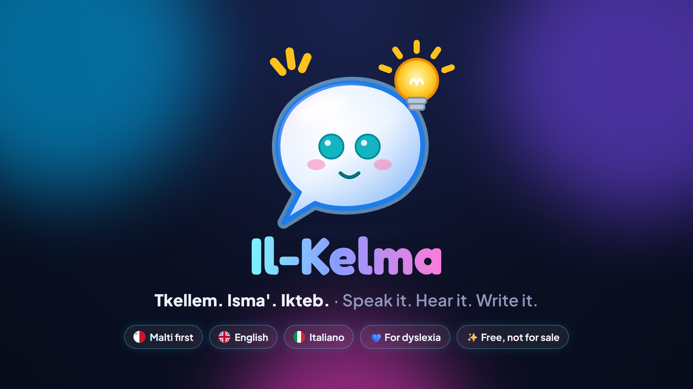
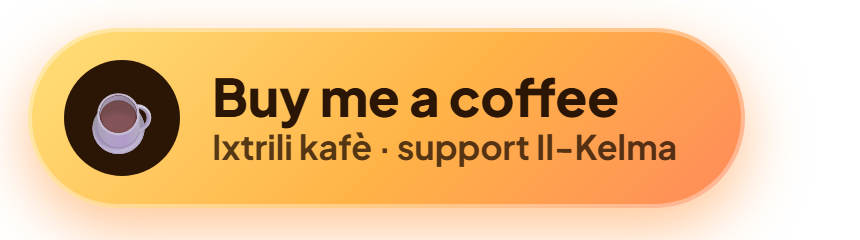
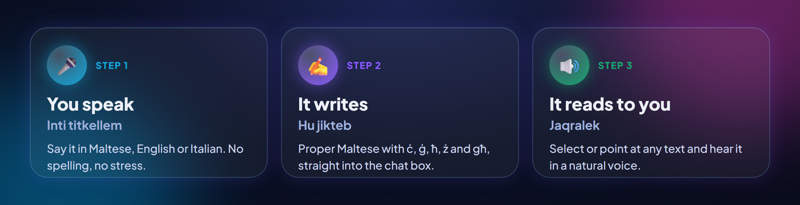
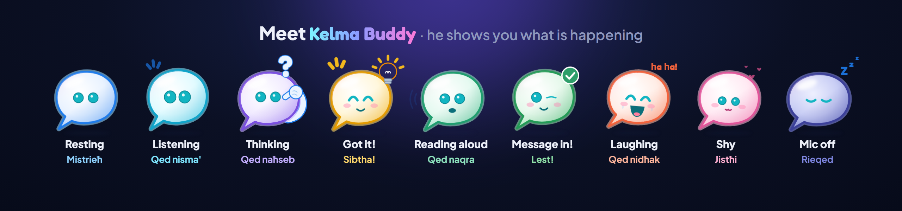
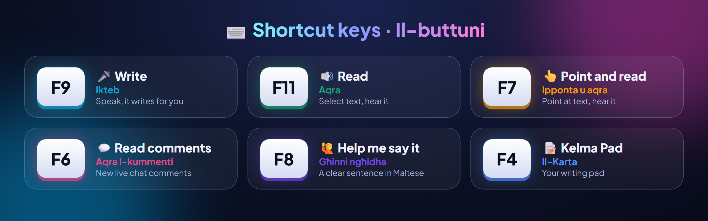

<p align="center">
  
</p>

<h2 align="center">🔊 <a href="https://debattistacliff-commits.github.io/Il-Kelma/">Isma' din il-paġna bil-Malti · Listen to this page</a></h2>

<h3 align="center">A free voice helper for people with dyslexia.<br>Made in Malta, Maltese first, and open to every language.</h3>

<p align="center">
  <b>🎤 You speak, it writes &nbsp;·&nbsp; 🔊 You point, it reads &nbsp;·&nbsp; ✨ ċ ġ ħ ż għ, always right</b>
</p>

<p align="center"><a href="https://buymeacoffee.com/debattistaj"></a></p>

---

## 🇲🇹 Why Il-Kelma

**The Maltese language deserves its place in the digital world.**

For many years, Maltese speakers were told that our language was too small for modern technology. Voice typing, reading aloud and spelling help arrived for the world's big languages. Maltese was too often left behind.

**Artificial intelligence is changing that.** Il-Kelma shows that a computer can **listen to Maltese, write it correctly and read it back**, with ċ, ġ, ħ, ż and għ in their rightful place. It works in the chat boxes people use every day, on different platforms.

> *"I started Il-Kelma to make everyday writing in Maltese easier. Now I want it to help others too, so that nobody is left behind because of reading or writing."*
> **Clifford Debattista**, founder

### Bil-Malti

Għal snin twal qalulna li l-Malti huwa lingwa żgħira wisq għat-teknoloġija. Illum, bl-intelliġenza artifiċjali, dan qed jinbidel. **Il-Kelma tisma' l-Malti, tiktbu sew u taqrahulek**, biex ħadd ma jibqa' lura minħabba l-qari jew il-kitba.

## 🌍 Not only Maltese

Il-Kelma already understands and speaks **English** and **Italian** too, and every comment or message is read in its own language. Each language is a simple *language pack*, so more languages can join. Our hope is that **any community whose language was left behind** can bring its own.

## ✨ How it works

<p align="center"></p>

## 🧰 What it does

| | |
|---|---|
| 🎤 **Write** · F9 | Speak in Maltese, English or Italian. Il-Kelma writes it into the chat box you were using. **It never presses send.** You check it and send it yourself. |
| 🔊 **Read** · F11 | Select any text and hear it in a natural voice. |
| 👆 **Point and read** · F7 | Point at text you cannot select, such as live chat comments, and hear it. |
| 💬 **Read new comments** · F6 | Draw a box around a live chat once, and every new comment is read aloud in its own language. Press F6 again to stop. |
| 🙋 **Help me say it** · F8 | Say what you mean, and it suggests a clear sentence in Maltese. |
| 📝 **Kelma Pad** · F4 | A calm writing pad made for dyslexia: big letters, easy fonts, colours, a reading ruler, words that light up as they are read, and **Fix letters**. Then **Put it in the chat**. |
| 🧠 **Learns with you** | It learns everyday Maltese words from what it reads, but only single words and never names or messages, so it understands you better over time. |

<p align="center"></p>

**Kelma Buddy** sits quietly in the corner of your screen. He shows you what is happening with his moods and talks to you, instead of popping up boxes. Drag him anywhere, clip him to a chat box, and change the language with the flags.

## ⌨️ Shortcut keys · Il-buttuni

<p align="center"></p>

| Key | What it does | Bil-Malti |
|:---:|---|---|
| **F9** | 🎤 Write: speak, and it writes for you | Ikteb |
| **F11** | 🔊 Read the selected text | Aqra |
| **F7** | 👆 Point at text and hear it | Ipponta u aqra |
| **F6** | 💬 Start or stop reading new comments | Aqra l-kummenti |
| **F8** | 🙋 Help me say it | Għinni ngħidha |
| **F4** | 📝 Open the Kelma Pad | Il-Karta |

If a key is already used on your computer, Il-Kelma picks another one and shows it in Settings. To **change the language**, click Kelma Buddy and press the **flag**: Malti → English → Italiano.

## 🔒 Privacy and respect

- Your voice is turned into text **on your own computer**.
- Read-aloud uses online neural voices for natural Maltese, and the computer's own voices when you are offline.
- Il-Kelma **never sends a message for you**, and it **never keeps people's names or messages**.
- Your personal words, corrections and writing stay on your computer.

## 🚧 Work in progress

Il-Kelma is young and growing. It is used every day by its first user and improves week by week. Some things are still rough, and that is fine: **every test, idea and correction makes it better.**

## ♿ For assistive technology

Il-Kelma's voice can live inside other tools. If you make **software or equipment for people with disabilities**, such as communication aids, eye-gaze systems, adapted keyboards or reading tools, you can use Il-Kelma's local API to add **Maltese speech-to-text, spelling repair and read-aloud** to your own product. Everything runs on the user's computer. A ready-to-use package for builders is on the way.

## 🤝 Support and partners

Il-Kelma is an open, non-commercial project, and **it grows faster with friends**. We warmly welcome:

- 🇪🇺 **European Union programmes, governments and public entities** that support language, education, inclusion and accessibility
- 🏛️ **Universities, schools and research groups** working on Maltese or other smaller languages
- 🏢 **Organisations, foundations and companies, small and large**, that want to sponsor, test or partner
- 🌍 **People anywhere in the world**: developers, designers, teachers, translators and testers

You are welcome to **fork** the project, suggest ideas, fix things or add a new language. Every bit of help counts, and it is received with real gratitude. To get in touch, open an **Issue** on this page and say hello.

If Il-Kelma helps you, you can also support it with a coffee. Thank you! · Grazzi!

<p align="center"><a href="https://buymeacoffee.com/debattistaj"></a></p>

## 💻 Install

Il-Kelma runs on Windows 10 and 11. A graphics card (GPU) makes it faster.

**The easy way:** install **Python 3.13** (tick *"Add python.exe to PATH"*), download this project, then double-click **`Install Il-Kelma.bat`**. It sets everything up and puts an **Il-Kelma** icon on your desktop. From then on, just double-click that icon.

**Or step by step**, in PowerShell:

```powershell
git clone https://github.com/debattistacliff-commits/Il-Kelma.git
cd Il-Kelma
python -m venv .venv
.venv\Scripts\python.exe -m pip install -r requirements.txt
.venv\Scripts\python.exe download_models.py   # speech models (several GB)
.venv\Scripts\python.exe download_data.py     # Maltese word data
```

Then double-click **`Start Il-Kelma.bat`**. Kelma Buddy appears in the corner of your screen.

## 🛠️ For builders

Il-Kelma has a small local API on `http://127.0.0.1:3420` (`/health`, `/transcribe`, `/fix`, `/speak`). See [docs/API.md](docs/API.md). Tests: `.venv\Scripts\python.exe -m unittest discover -s tests`

## 🙏 Licences and thanks

- **Code:** [MIT](LICENSE).
- **Maltese data:** see [DATA_LICENSES.md](DATA_LICENSES.md). Korpus Malti (MLRS, University of Malta) is CC BY-NC-SA 4.0, so **the Maltese data is free and may not be sold**.
- With thanks to MLRS at the University of Malta, the MaCoCu project, SPELL-MT, hunspell-mt, the authors of the Maltese speech model, and the open-source Handy project, which inspired the idea.

<p align="center"><b>Il-Kelma · Tkellem. Isma'. Ikteb.</b></p>
